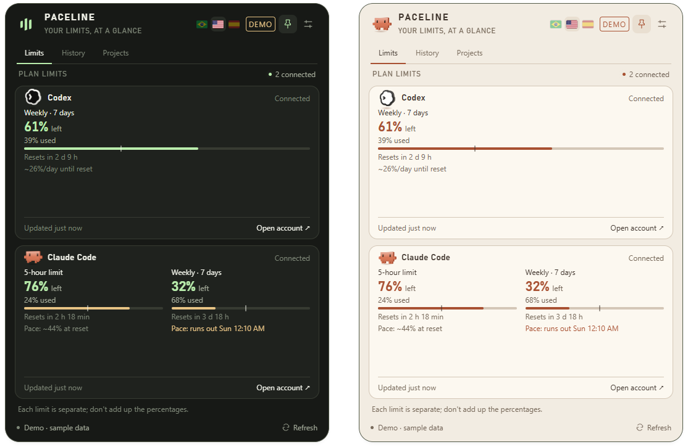

# Paceline

A small desktop overlay for keeping an eye on Claude Code and Codex subscription limits. It hides at the edge of your screen and opens when you need it; choose the top, bottom, left or right edge.

**Local first. Automatic provider limits, local token counts and a monitor that follows your work.**

This is an early desktop release for Windows and macOS, built with Electron and vanilla JavaScript. [Leia em português](README.pt-BR.md).



*The Paceline and Claude themes with sample readings; not a promise of account limits.*

## Download

Get the latest version from the [Releases page](https://github.com/rafaelbauer-ai/Paceline/releases/latest):

- **Windows 10/11 (x64):** the installer (`Paceline-…-setup-x64.exe`) or the portable app (`Paceline-…-windows-x64.exe`), which runs without installing.
- **macOS 12 or newer (Apple Silicon and Intel):** the disk image (`Paceline-…-mac-universal.dmg`).

The builds are not code-signed yet. Windows may show a SmartScreen warning (**More info → Run anyway**), and macOS asks you to approve the first launch (see [macOS](#macos)). Paceline reads your limits through the official [Claude Code](https://code.claude.com/docs/en/setup) and [Codex](https://developers.openai.com/codex/cli/) CLIs, so install and sign in to the ones you use.

## What it does

- Collapses into a discreet tab; expands into a usage dashboard.
- Shows available usage windows, percentage used/remaining, reset times, connection status and data freshness.
- Reads Codex limits through the official local `codex app-server` protocol.
- Reads Claude limits from the account usage endpoint with your existing Claude Code CLI login, including when you work in the Claude desktop app. The `statusLine` bridge remains an optional extra source.
- The mascots follow your agents: busy while Claude Code or Codex runs a turn, celebrating when it ends, and an optional notification when a task of a minute or more finishes.
- Shows each window's pace: a tick on the bar marks where an even pace would leave you, and one line says when you'd run out or how much per day is left.
- Records quota readings for 24-hour and 7-day charts, with up to 30 days of local history; Codex's own logs fill in the time Paceline was closed.
- Groups local tokens by project/session from Codex logs and Claude Code transcripts (terminal and desktop app), separately from subscription percentages.
- Offers Paceline, Codex-neutral and Claude warm themes; optionally follows the active provider app.
- Customizes scale, opacity, hide delay, visible providers and alerts: low-remaining levels in the same unit as the cards, a weekly pace warning and a "freed again" notice after a tight window. Clicking a notification opens the panel.
- Provides an assisted Windows installer plus portable build, a universal macOS disk image (Apple Silicon and Intel), and an explicit verified-update flow for a configured GitHub publisher.
- Keeps settings and sanitized metrics locally. No Paceline cloud account or telemetry.

The collapsed tab is vertical on side edges and horizontal on top/bottom edges. Quota bars always show what remains; each limit also states the used percentage.

Hover the tab to expand, move away to collapse, or pin it open. `Ctrl+Alt+V` (`Control+Option+V` on macOS) toggles the panel and `Esc` returns from a subview, then collapses the main panel. The tray menu (the menu bar icon on macOS) restores the overlay, chooses a monitor, and controls notifications. Low-remaining alerts default to 20% and 5% left and can be customized; opening at login is optional. Drag the title to reposition the panel.

Percentages represent subscription rate limits, **not exact tokens or money**. Missing windows stay unavailable; old readings are marked stale instead of being invented.

## Windows installer

The installer (`Paceline-…-setup-x64.exe`) installs per user, without administrator rights, with a folder picker, shortcuts and an uninstaller. The portable executable runs without installing. The uninstaller restores the Claude integration and retains local data. [Installation, updates and signing](docs/UPDATES.md) explains the details and migration between folders.

The builds are not code-signed, so Windows may show a publisher warning. Only the optional terminal bridge requires Node.js on `PATH`.

## macOS

Open `Paceline-0.4.0-mac-universal.dmg` and drag Paceline into Applications. It runs on macOS 12 or newer, on Apple Silicon and Intel, and lives in the menu bar without a Dock icon.

The app is ad-hoc signed but not notarized by Apple, so the first launch shows that Apple could not verify the developer. Open it once from **System Settings → Privacy & Security → Open Anyway** (on macOS 14 and older, Control-click the app and choose **Open**). Alternatively run `xattr -dr com.apple.quarantine /Applications/Paceline.app`. Later launches and updates downloaded by Paceline itself open normally.

On macOS:

- Data lives in `~/Library/Application Support/Paceline`.
- The Claude Code CLI keeps its login in the Keychain. When Paceline reads it, macOS may ask once whether to allow access.
- Paceline finds `claude`, `codex` and `node` through your login shell's `PATH`, so CLIs installed by Homebrew, npm or the official installers work when the app is opened from Finder.
- **Sign in to Claude** opens `claude auth login` in your terminal app.
- If alerts do not appear, allow Paceline under **System Settings → Notifications**.

## Run from source

Requirements: Windows 10/11 or macOS 12+, Node.js 22 or newer, npm, and the official CLIs for the providers you want to connect.

```powershell
cd paceline
npm ci
npm start
```

Run them inside your checkout. Windows and macOS are the supported desktop targets. Connector tests also run on Linux in CI, but Linux is not a release target.

## Connect your tools

### Codex

1. Install the official [Codex CLI](https://developers.openai.com/codex/cli/).
2. Sign in using `codex login` and your supported ChatGPT account.
3. Open Paceline and connect/refresh Codex. If the CLI is not signed in, the connection action opens the official browser login. A login in the Codex desktop app does not always mean the standalone CLI is already signed in.

Paceline starts the local app server and uses `account/rateLimits/read`, with update notifications when available. Codex owns the login and credentials. Paceline does not read its token files or ask for your password. API-key-only accounts may not expose subscription limits. If Codex is not found automatically, put it on `PATH` or set `PACELINE_CODEX_COMMAND` to its absolute executable path before starting the app.

Protocol references: [Codex app server](https://developers.openai.com/codex/app-server/) and [account rate limits](https://learn.chatgpt.com/docs/app-server#6-rate-limits-chatgpt).

### Claude Code

1. Install the official [Claude Code](https://code.claude.com/docs/en/setup) CLI.
2. Open Paceline. If the CLI is not signed in, **Sign in to Claude** on the card opens the official `claude auth login` in its own window; when it expires, **Renew sign-in** does the same. The 5-hour and weekly limits (and per-model weekly limits when your plan has them) then appear on their own, whether you use Claude Code in a terminal or in the Claude desktop app.
3. Optional, under Settings → Connections → Terminal bridge: the status-line bridge (requires Node.js on `PATH`) adds a reading after every terminal response.

**How the account reading works.** Paceline reads the `accessToken` that the Claude Code CLI keeps in `.credentials.json` (in `CLAUDE_CONFIG_DIR` or `~/.claude`). On macOS the CLI keeps the same login in the Keychain item `Claude Code-credentials`, which Paceline reads with the system `security` tool when that file is absent. It sends that token only to `https://api.anthropic.com/api/oauth/usage`, the endpoint behind Claude Code's `/usage`. The token stays in memory for that request; it is never logged, stored or sent elsewhere, and the refresh token is never used. Paceline makes at most one request every 4 minutes, honours `Retry-After` across restarts and never sends an expired token. Near expiry it runs the official `claude auth status` at most every 30 minutes so the CLI can renew its own login. Claude Code inside the Claude desktop app does not write this file, so the terminal CLI login is required. The endpoint is not publicly documented and may change. Review Anthropic's [authentication and credential use](https://code.claude.com/docs/en/legal-and-compliance#authentication-and-credential-use) policy before distributing this build.

The bridge receives Claude Code's status-line JSON and stores only allowlisted usage metrics. It does not collect OAuth tokens, prompts or conversations. Setup makes a local backup of the existing Claude settings and provides a removal path. That backup can contain commands or environment values you previously saved in Claude settings; treat it as private. Review the integration settings before using it alongside another status-line tool.

Status-line readings require Claude Code to provide the `rate_limits` fields for your version and account (supported Pro/Max or gateway spend-limit data), and only arrive after an API response in a terminal session. When no source can be reached, Paceline displays the latest reading and its age. Check provider UI for the authoritative current limit.

You can also install or remove the bridge from the checkout:

```powershell
node scripts/install-claude-bridge.cjs --data-dir .local\data
node scripts/install-claude-bridge.cjs --data-dir .local\data --uninstall
```

The data directory must be the same one used by the desktop app. Identical status-line readings do not renew the freshness timestamp, while an account reading does; missing metrics preserve the last known reading.

To avoid older concurrent sessions replacing newer readings, the bridge keeps bounded local SHA-256 session fingerprints and metric digests (no raw session identifiers or conversations). Within the same reported reset window it conservatively retains the highest observed consumption. After switching Claude accounts, close sessions from the previous account and clear this local reading with `node scripts/install-claude-bridge.cjs --data-dir "<your-data-directory>" --reset-usage`, then use the new account. This does not reset provider quotas or sign you out.

Official references: [status-line data](https://code.claude.com/docs/en/statusline) and [authentication and credential use](https://code.claude.com/docs/en/legal-and-compliance#authentication-and-credential-use).

## Local data and privacy

Development state lives in `.local/data/`. The Windows builds keep their data in `paceline-data/` beside the executable; the macOS app uses `~/Library/Application Support/Paceline`. Set `PACELINE_HOME` to choose a different location; use a writable folder.

The overlay does not upload metrics, proxy AI requests or scrape browser sessions. Provider CLIs still communicate with their own services using their existing authentication. The Claude Code login token is used only for the usage request described above. Local settings, caches, backups, logs, databases and build output are excluded from Git and release packages.

## Develop and build

```powershell
npm test                  # Node provider and app tests
npm run pack              # Unpacked desktop application
npm run dist:win          # Windows installer + portable + update manifest
npm run dist:mac          # macOS universal disk image + update manifest (on a Mac)
```

Build output is generated in `release/` and must not be committed. The portable artifact is `release/Paceline-0.4.0-windows-x64.exe`; the installer is `release/Paceline-0.4.0-setup-x64.exe`, accompanied by `paceline-update.json`. Builds are unsigned unless a real certificate is configured, so Windows may display a publisher warning. The macOS disk image is `release/Paceline-0.4.0-mac-universal.dmg` with `paceline-update-mac.json`; it is ad-hoc signed and not notarized. macOS apps can only be built on a Mac, and the GitHub Actions workflows build it on a macOS runner. Public release publishing and code signing are separate maintainer steps; see [PUBLISHING.md](docs/PUBLISHING.md).

The 0.3.0 dependency update removed the previously flagged build chain; `npm audit` reported zero known findings at validation. Review a fresh audit before distributing each release.

## History, local tokens and forecasts

Subscription charts contain readings collected while Paceline runs, plus the official Codex limit readings found in Codex's own session logs from the last 30 days. They do not reconstruct an account's entire past.

The pace comes from each window's own clock: a window opens at 0% used, so usage so far divided by the time already elapsed projects the usage at the reset. It needs no history and appears from the first reading, except in the first minutes of a window, when the average is noise. For multi-day windows the app also shows how much per day is left until the reset and, in History, how much was used today. It is an estimate, not a promise of when a provider will block usage.

Project/session totals are local token observations, not currency or subscription billing. Codex usage comes from local session metadata; Claude usage comes from Claude Code's transcripts, each response counted once. The headline number leaves out cache reads, which cheaply repeat the same context. The first reading of a large transcript history takes a few minutes in the background. See [PRIVACY.md](docs/PRIVACY.md) for exactly what is read and retained.

In settings, choose a fixed theme or enable active-app following. This recognition is local and approximate: a terminal or browser title may not uniquely identify its provider. macOS does not expose window titles without a screen-recording permission, so there Paceline recognizes the Claude and Codex desktop apps, and terminals or editors in which exactly one of the two CLIs is running. Browser tabs, and terminals such as iTerm2 that start their sessions outside the app, keep the last provider. You can always select the theme yourself.

## Updates

Enter a trusted public `owner/repo` in update settings (`rafaelbauer-ai/Paceline` for the official builds), then check, download and install explicitly. Downloaded installers are bound to the selected release and verified with SHA-256, SHA-512 and size checks before execution. No repository is selected by default; without a published stable release and manifest, the app explains that updates are not configured/available. Checksums are integrity checks, not a substitute for a trustworthy publisher or code signing. [Update details](docs/UPDATES.md).

## Contribute

See [CONTRIBUTING.md](CONTRIBUTING.md) for setup and review expectations, and [SECURITY.md](SECURITY.md) for private vulnerability reporting. Contributions should preserve supported provider interfaces, explain unavailable data clearly and keep credentials outside the app.

[MIT license](LICENSE). Independent project; not affiliated with or endorsed by OpenAI or Anthropic. Product names belong to their respective owners.
